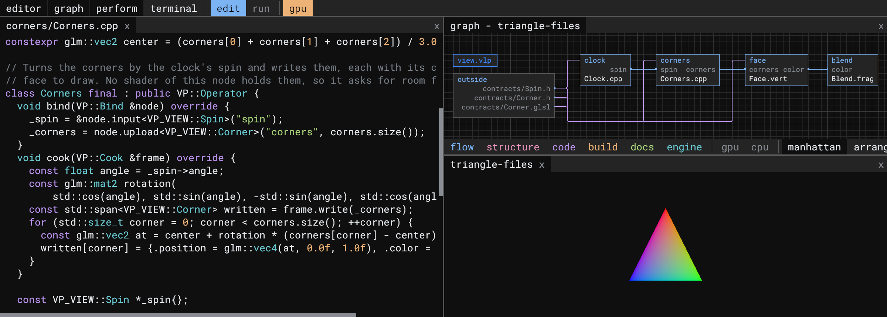

<h1 align="center">Correlate Visuals</h1>

  <b>GPU simulation and real-time visuals, built in C++, Vulkan and GLSL.</b> 
  Engines where data stays on the GPU, programs are graphs, and every result can be replayed.

  
  
  
  
  
  
  

## Vulpen

**Write C++ and GLSL side by side. Wire them as a graph. Change them while they run.**

Vulpen is a Vulkan engine for real-time visuals and GPU compute whose programs are nodes and connections. A small manifest names the nodes, and each node is a folder of C++, shaders, or both.

- **Programs are graphs.** Vulpen places every Vulkan barrier from the connections between nodes.
- **C++ and GLSL meet by name.** A node's C++ asks for its shaders' values, buffers and images by the names the shaders give them, checked against SPIR-V reflection before the first frame.
- **Live code.** Save a C++ or GLSL file and the running project swaps the change in.
- **Every action is a command.** Anything the IDE does can be typed, scripted, replayed from a log, or run headless on a server.
- **Built to run for years.** Output is deterministic, memory stays bounded, and soak runs prove it.

Linux and Windows · Mozilla Public License 2.0 · [github.com/CorrelateVisuals/Vulpen](https://github.com/CorrelateVisuals/Vulpen)

## From one simulation to an engine

| | |
| --- | --- |
| **[CAPITAL Engine](https://github.com/CorrelateVisuals/CAPITAL-Engine)** · 2023 | A cross-platform C++ and Vulkan engine running Conway's Game of Life in a compute shader. |
| **Generations** · in development | The same cells grown into a society: they produce, trade and build roads across a terrain, all in Vulkan compute shaders. |
| **Vulpen** · 2026 | The engine those simulations asked for. Life is one of its example projects again: three nodes and two connections. |

## Also on GitHub

| Repository | What it is |
| --- | --- |
| [TouchDesigner_Tools](https://github.com/CorrelateVisuals/TouchDesigner_Tools) | Components for TouchDesigner: astronomical FITS scaling, Voronoi diagrams, images to drone-show points, point-cloud export and Hertzsprung–Russell diagrams. |
| [CUDA_Kernels](https://github.com/CorrelateVisuals/CUDA_Kernels) | CUDA kernels exploring GPU memory management, thread organization and data parallelism. |
| [OpenCL_Kernels](https://github.com/CorrelateVisuals/OpenCL_Kernels) | OpenCL kernels for image processing and parallel algorithms, on any vendor's GPU. |
| [Turtle-OS](https://github.com/CorrelateVisuals/Turtle-OS) | A learning environment for children: slideshows for exploring math, images, reading and writing. |
| [The-Word](https://github.com/CorrelateVisuals/The-Word) | The whole Bible as an Obsidian knowledge graph: books, people, places, themes and timeline, cross-referenced. |

## Focus

- **GPU simulation:** cellular automata and agent systems in Vulkan compute shaders, with CUDA and OpenCL where they fit.
- **Real-time visuals:** Vulkan rendering and GLSL, and TouchDesigner for installations and live performance.
- **Knowledge modelling:** structuring data and ideas so they can be computed, connected and seen, with Python for the data around them.
